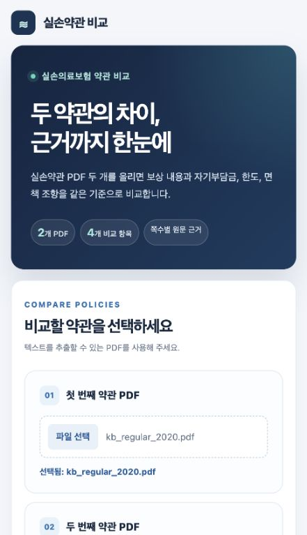
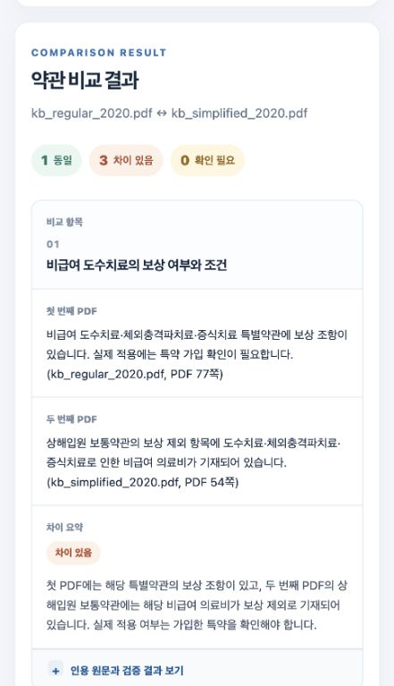
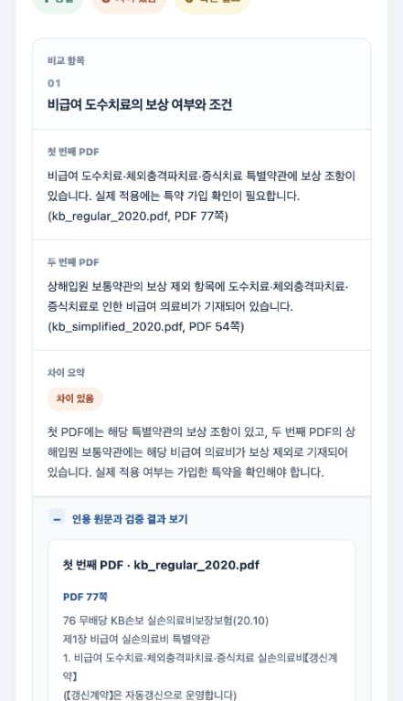
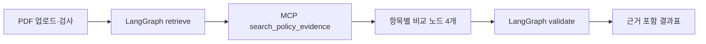

# G097 황가인 | 실손의료보험 약관 비교 에이전트

> 과제 2 · 신규 프로젝트 결과보고서 및 실행 안내

두 실손의료보험 약관 PDF를 업로드하면 **비급여 도수치료, 상해입원 자기부담금, 상해입원 보장 한도, 임신·출산 관련 면책**을 한 번에 비교합니다. 결과에는 `동일`·`차이 있음`·`확인 필요` 상태와 파일명, PDF 쪽수, 인용 원문을 표시합니다. 약관 문구를 비교하는 도구이며 개인의 실제 보장 여부를 확정하지는 않습니다.

## 1. 진행 사항과 주요 기능

기존 장애 대응 학습용 에이전트와 별도로 `insurance_compare/` 모듈과 PDF 업로드 화면을 만들었습니다. 이번 보완에서는 보험 비교의 실제 실행 경로에 **LangGraph 작업 흐름과 MCP 근거 검색 도구**를 연결했습니다. 기존 `agent/graph.py`와 루트의 `mcp_server.py`는 다른 실습용 코드입니다.

| 구분 | 기존 학습용 프로젝트 | 이번 프로젝트 |
|---|---|---|
| 입력 | 자유 대화 | 실손약관 PDF 2개 업로드·형식 검사 |
| 결과 | 일반 답변 | 4개 항목의 상태와 차이 요약을 담은 비교표 |
| 근거 | 원문과 답변의 연결 없음 | 파일명·PDF 쪽수·인용 원문 표시 |
| 검증 | 모델 응답 중심 | 보장 유형 구분, 수치·출처 검증, 근거 부족 시 판단 보류 |
| 화면 | 기존 대화 화면 | 분리된 업로드 화면과 항목별 원문 펼치기 |

PDF의 확장자·헤더·크기(최대 25MB)·쪽수(최대 500쪽)·텍스트 추출 가능 여부를 검사한 뒤, 쪽별 근거를 검색합니다. 구조가 명확한 조항은 규칙으로 비교하고, 인식하기 어려운 일부 도수치료·한도 문구에만 OpenAI 모델의 구조화된 응답을 보조적으로 사용합니다. 인용이나 수치가 검증되지 않으면 `확인 필요`로 남깁니다.

## 2. 실행 화면과 결과

### PDF 업로드



### 최종 비교 화면

2020년 일반형과 간편가입형을 비교했을 때 **4개 항목 중 3개는 차이 있음, 1개는 동일**로 표시됐습니다. 결과 행을 펼치면 인용 원문과 PDF 쪽수를 볼 수 있습니다.





| 입력 PDF | 도수치료 | 자기부담금 | 보장 한도 | 임신·출산 면책 |
|---|---|---|---|---|
| 2020 일반형 ↔ 간편가입형 | 차이: 일반형 77쪽 ↔ 간편가입형 54쪽 | 차이: 양쪽 9쪽 | 차이: 51쪽 ↔ 49쪽 | 동일: 58쪽 ↔ 53쪽 |
| 2022 ↔ 2023 | 동일: 양쪽 42쪽 | 동일: 양쪽 10~11·38쪽 | 동일: 양쪽 17·50쪽 | 동일: 양쪽 15·45쪽 |

쪽수는 PDF 뷰어 기준입니다. 2020년 도수치료 결과는 일반형 **특별약관의 보상 조항**과 간편가입형 **상해입원 보통약관의 제외 조항**을 구분합니다. 특별약관 가입 여부, 보험가입금액 등 개인 계약 내용은 별도로 확인해야 합니다.

## 3. 사용한 기술 요소



| 기술 요소 | 구현 위치와 역할 |
|---|---|
| Agent Graph | `insurance_compare/policy_graph.py`의 `retrieve → 항목별 비교 노드 4개 → validate`. 네 노드는 항목별 역할을 맡는 작업자이며, 독립적인 대화형 자율 에이전트는 아닙니다. |
| MCP | `policy_mcp_server.py`의 `search_policy_evidence` 도구를 `policy_mcp_client.py`가 별도 stdio 프로세스에서 호출하여 페이지별 조항 후보를 받습니다. |
| RAG | `generic_evidence.py`가 필수어와 가중치로 관련 페이지를 찾고, 상위 발췌문을 비교 입력의 근거로 사용합니다. 키워드 기반 검색이며 벡터 DB·임베딩은 사용하지 않았습니다. |
| 의존성 주입 | `policy_graph.py`의 `PolicyDeps`에 검색 클라이언트·비교 함수·출력 함수를 주입합니다. 테스트에서는 가짜 검색 클라이언트로 교체합니다. |
| 출처 검증 | `generic_compare.py`와 그래프의 `validate`가 인용 쪽수·원문 수치·양쪽 근거를 확인하고, 부족하면 결론을 보류합니다. |
| LangSmith | 노드와 MCP 호출에 추적 계측을 추가했습니다. PDF에 민감정보가 있을 수 있어 기본값은 비활성화이며, 공개 시연 PDF에서만 `POLICY_LANGSMITH_TRACING=1`로 켤 수 있습니다. |
| 모듈화·단위 테스트 | PDF 입력, 근거 검색, 항목별 규칙, 그래프, MCP, 웹 API와 프론트엔드를 분리했습니다. `insurance_compare/tests/`의 테스트 9개가 통과했습니다. |

## 4. 검증

`python -m unittest discover -s insurance_compare/tests -v`로 **9개 테스트**를 통과했습니다. PDF 형식 오류, 근거가 없는 경우, 한쪽에만 근거가 있는 경우, 통원 수치가 입원 비교에 섞이는 문제, 면책 예외 누락, 그래프의 항목 순서와 근거 없는 결론 보류를 검사했습니다. 2020년과 2022·2023년의 실제 PDF 두 쌍에서도 네 항목의 판정과 인용 쪽수를 대조했습니다.

개선 전·후의 지연시간이나 비용을 같은 입력으로 측정한 수치는 이번 보고서에 포함하지 않았습니다.

## 5. 한계와 이후 개선

- 스캔 PDF와 암호화 PDF는 처리하지 않습니다. OCR을 추가하면 입력 범위가 넓어지지만 인식 오류와 처리 시간이 늘어납니다.
- 키워드 검색은 표현이 크게 다른 약관의 관련 페이지를 놓칠 수 있습니다. 평가용 질의·정답 세트를 만든 뒤 하이브리드 검색과 비교하고 싶습니다.
- 별도 MCP 프로세스 실행은 로컬 함수 호출보다 느릴 수 있어 서버 재사용과 캐시가 후속 과제입니다.
- 출처·수치 검증만으로 약관의 법적 의미와 개인별 보장을 확정할 수 없습니다. 보험증권과 가입 특약을 함께 확인해야 합니다.
- LangSmith 추적을 켜면 문서 텍스트가 외부 서비스에 기록될 수 있으므로 개인 계약 문서에는 기본값인 추적 비활성화를 유지합니다.

이번 작업에서 중요했던 점은 답변을 길게 생성하는 것보다 **비교한 조항을 보여주고 근거가 부족할 때 판단을 보류하는 것**이었습니다.

## 6. 실행 및 재현

```bash
python -m pip install -r requirements.txt
python -m unittest discover -s insurance_compare/tests -v
python -m uvicorn insurance_compare.upload_web:app --host 127.0.0.1 --port 8702
```

브라우저에서 `http://127.0.0.1:8702/`를 열고 텍스트를 추출할 수 있는 PDF 두 개를 업로드합니다. 기본값은 전체 4개 항목 비교이며 단일 항목 비교도 가능합니다. 다른 포트가 필요하면 명령의 `--port` 값을 바꾸면 됩니다.

익숙하지 않은 약관 문구의 AI 보조 비교에는 `.env`의 `OPENAI_API_KEY`가 필요합니다. PDF 원본과 `.env`는 Git에 포함하지 않았습니다. [시연 가이드](DEMO_GUIDE.md)와 [시연 기준 답안](DEMO_EXPECTED.md)도 참고할 수 있습니다.
